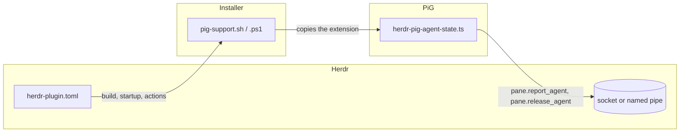

# Architecture

herdr-pig makes [PiG](https://github.com/MichaelKinsy/PiG) report its own state
to [Herdr](https://herdr.dev). It has two parts that run at different times and
in different processes:

| Part | File | Runs in | Runs when |
| --- | --- | --- | --- |
| Extension | `extensions/herdr-agent-state.ts` | PiG's extension host | A `pig` session runs in a Herdr pane |
| Installer | `scripts/pig-support.sh`, `scripts/pig-support.ps1` | A shell started by Herdr, or by hand | The plugin is installed, Herdr starts, or an action is invoked |

`herdr-plugin.toml` connects the installer to Herdr. Nothing connects the
extension to Herdr except the environment Herdr gives every pane.

## The extension

The extension is one file with no dependencies beyond Node's `net` and `path`.
It has to stay that way: the installer copies that single file into PiG's agent
directory, and nothing else comes with it.

### When it is active

It does nothing unless all of these hold:

- `HERDR_ENV=1`, `HERDR_SOCKET_PATH` and `HERDR_PANE_ID` are set. Herdr sets
  them for every pane, so outside Herdr the extension returns at once.
- The session runs in TUI mode. Print, JSON and RPC modes have no pane for
  Herdr to show.

### State

The extension reduces PiG's lifecycle events to one of three states:

| PiG event | Effect |
| --- | --- |
| `session_start` | Marks the root session, records the resume command, reports the current state |
| `agent_start` | `working` |
| `agent_settled`, when PiG is idle | `idle` |
| `herdr:blocked` on the `pi.events` bus | `blocked` while at least one holder is active |
| `session_shutdown` with reason `quit` | Releases the pane |

`blocked` wins over `working`, which wins over `idle`. A session switch or a
reload does not release the pane, because PiG is still in it.

`herdr:blocked` is a convention shared with Pi: another extension emits
`{ active, label }` to say the agent is waiting on the user. The extension
counts holders, so two overlapping blockers do not clear each other.

### Reporting

Reports follow Herdr's
[Add Herdr support to your agent](https://herdr.dev/docs/add-herdr-support/)
contract. Each one is a line of JSON sent over a new connection:

- `pane.report_agent` carries the state and, when known, `resume_argv`.
- `pane.release_agent` tells Herdr that PiG has left the pane.

Three details keep the reports correct:

- **Sequence numbers.** Herdr drops a report whose `seq` is not higher than the
  last one it accepted. The counter starts from the clock, so it keeps rising
  across PiG restarts.
- **Latest state wins.** One send is in flight at a time. A newer state
  replaces anything still queued, so a slow socket never delivers stale states
  in a burst.
- **Retry once.** A send that gets no answer in 500 ms is retried with a
  1500 ms limit, then given up. Reporting must never hold PiG up.

### Resume command

The resume command is `pig --session <file>`, falling back to the session id
when there is no absolute session file. Herdr rejects a command whose arguments
contain an apostrophe or a control character, and rejecting it drops the whole
state report. `isSafeResumeArg` filters those out, so an odd path costs the
resume command and not the state.

### Transport

On Linux and macOS `HERDR_SOCKET_PATH` is a Unix socket path. On Windows it is
the name of a named pipe, reached at `\\.\pipe\<name>`. Herdr's own Pi
integration builds the address the same way.

## The installer

The installer copies the extension to
`<agent dir>/extensions/herdr-pig-agent-state.ts`. The agent directory follows
PiG's own lookup: `PIG_CODING_AGENT_DIR`, then `PIG_HOME/agent`, then
`~/.pig/agent`.

It has four commands:

| Command | Does | Used by |
| --- | --- | --- |
| `install` | Copies the extension | The `[[build]]` step and the install action |
| `uninstall` | Removes the copy | The uninstall action |
| `status` | Says whether the copy is missing, current or outdated | The status action |
| `refresh` | Updates an existing copy, and never creates one | The `[[startup]]` hook |

### Ownership

The extension carries the marker `HERDR_PIG_EXTENSION_VERSION=`. The installer
only overwrites or removes a file that has it. A file of the same name without
the marker belongs to someone else, and the installer refuses to touch it.

`refresh` only updates a copy that is already there. Without that rule, a user
who uninstalled the extension would get it back the next time Herdr started.

### Refusals

`install` stops with a reason when:

- PiG's agent directory does not exist, which means PiG has never been run.
- `PIG_USE_PI_DIRS=1`. PiG then shares Pi's extension directory, so Pi would
  load the extension too and report itself as PiG.
- An unmanaged file already has the extension's name.

During `herdr plugin install` a refusal aborts the install, so a plugin never
looks installed while doing nothing.

### Two scripts

`pig-support.sh` serves Linux and macOS, and `pig-support.ps1` serves Windows.
They have the same commands, the same messages and the same exit codes. Herdr
picks one through the `platforms` field on each manifest entry, which is why
every entry appears twice and Windows actions have a `-windows` suffix.

The PowerShell script has to run under Windows PowerShell 5.1, the version
every Windows machine has. It avoids `Get-FileHash`, which fails to load when
5.1 is started from PowerShell 7.

### Uninstall

Herdr has no uninstall hook. `herdr plugin uninstall` removes the plugin's
checkout and leaves the copied extension in PiG's agent directory, where it
keeps working. The uninstall action has to be run first.

## Tests

- `test/herdr-agent-state.test.ts` loads the extension against a fake Herdr
  that listens on a real socket, or a real named pipe on Windows, and checks
  the requests it receives.
- `test/pig-support.test.ts` runs one set of cases against both installer
  scripts, in a temporary home directory. It also runs the manifest's build
  step for the current platform, and checks that every manifest entry has a
  form for each supported platform.

CI runs both files on Linux, macOS and Windows. The PowerShell script is
tested under `pwsh` on Linux and macOS, and under Windows PowerShell on
Windows.

## Tooling

`mise.toml` pins the tools and defines the tasks. Contributors, the git hooks
and every CI job run the same tasks, so there is one definition of each check.

## Releases

Versions live in `package.json` and `herdr-plugin.toml`, and must match.
[semantic-release](https://github.com/semantic-release/semantic-release) keeps
them in step: on every merge to `main` it reads the commits since the last
`v*` tag, bumps both files, updates `CHANGELOG.md`, commits, tags and creates
the GitHub release. `release.config.mjs` holds the configuration. See
[CONTRIBUTING.md](CONTRIBUTING.md) for the commit rules that drive it.
